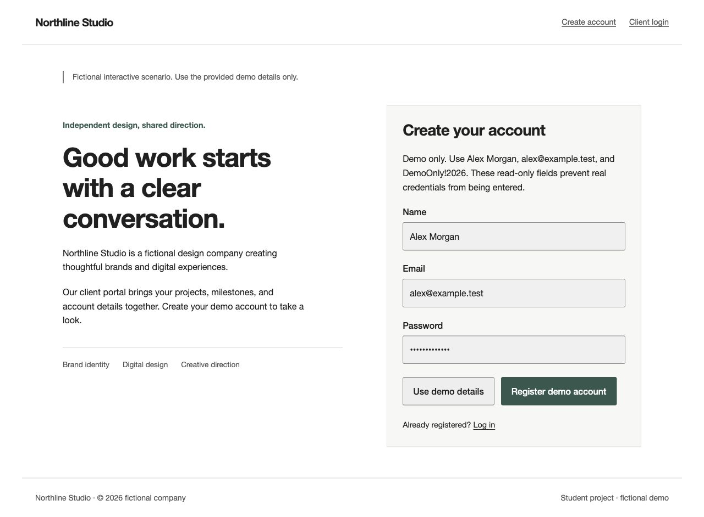
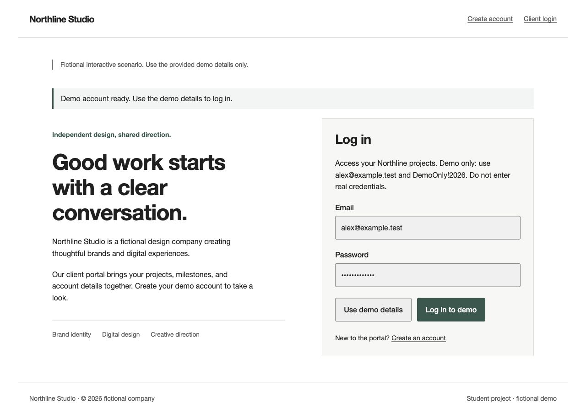
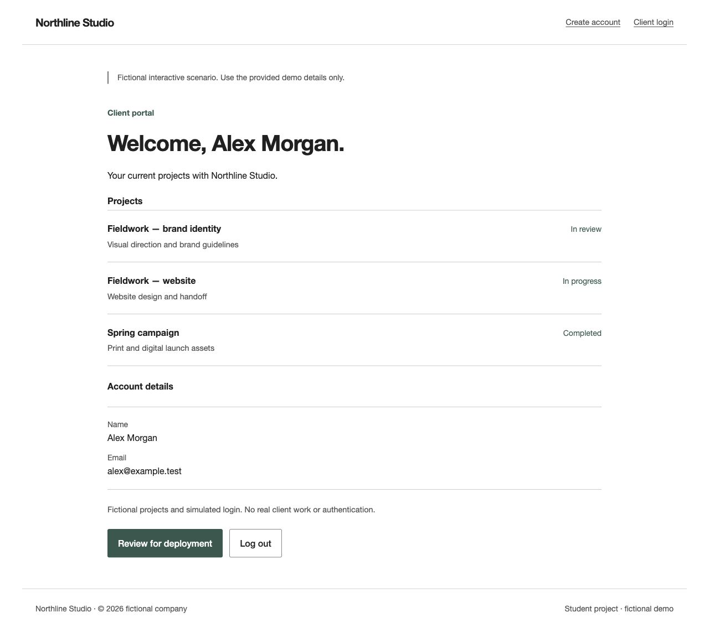
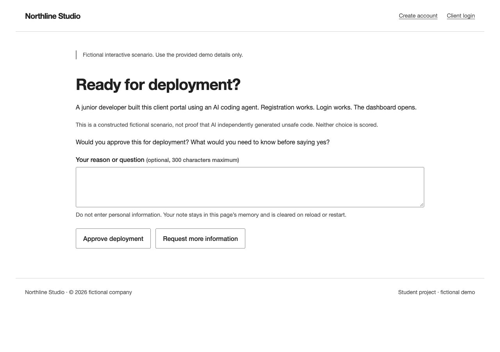
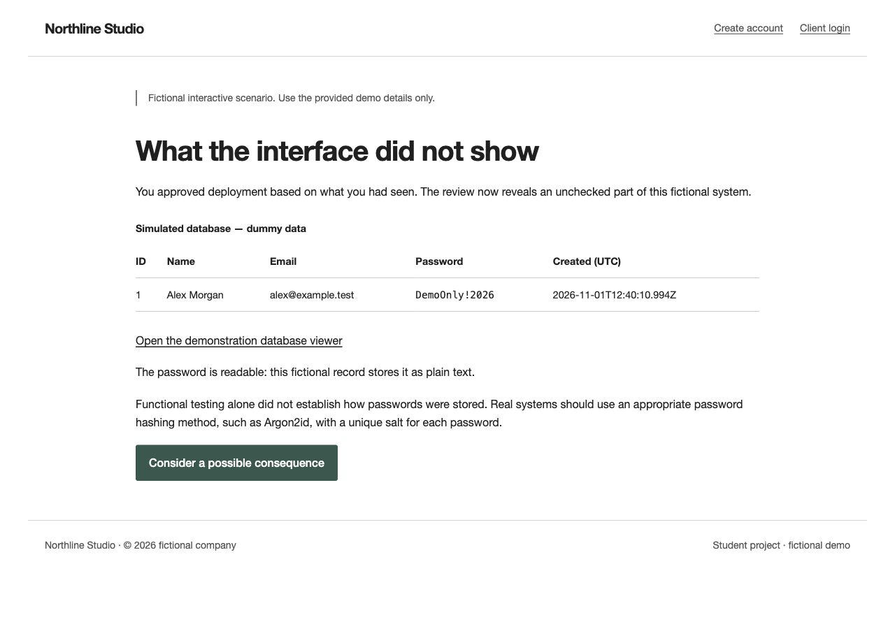
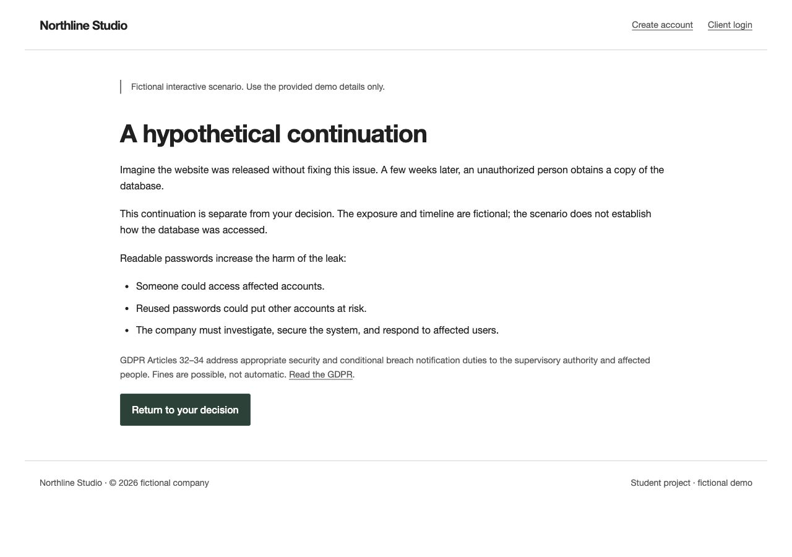
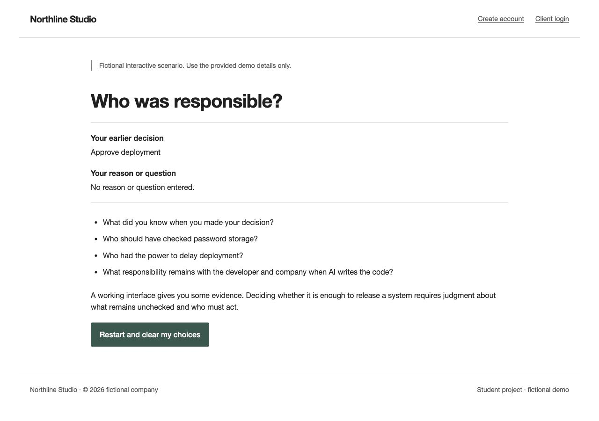

# PHKI A1: Northline Studio

- Project: [phki-a1-project.vercel.app](https://phki-a1-project.vercel.app)
- Format: interactive client portal and fictional deployment review.
- Focus: responsibility when junior developers use AI coding agents.

## Project question

“How does relying on AI coding agents affect a junior web developer’s ability to identify security risks before deploying a website that handles users’ personal data?”

## Digital product

### Registration

- Visitors register using fixed demo details.

### Login

- The registered demo account opens the client portal.

### Dashboard

- Fictional projects and account details make the website appear functional.
- “Review for deployment” starts the scenario.

### Deployment decision

- Approve deployment or request more information before seeing the hidden problem.

### Database reveal

- The dummy password is stored as readable text.
- A working interface does not establish secure password storage.

### Hypothetical consequence

- A fictional leak shows how readable passwords could increase harm.
- The scenario does not explain how the database was accessed.

### Responsibility

- The audience revisits its decision: who should have checked, who could delay release, and who remains responsible?
- Screenshots show the approval branch, captured from the live site on 1 November 2026.

## AI use

- Model: OpenAI ChatGPT Codex 6.1 Sol Light.
- AI-assisted work: code, interface and checks
- [Three complete development prompts](DEVELOPMENT_PROMPTS.md).

## Demo details

- Static HTML, CSS, and JavaScript, fixed dummy data stored in each visitor’s browser.
- [Database viewer](https://phki-a1-project.vercel.app/database.html): inspect and export the dummy account.
- Audience choices and reasons stay in memory only.
- Constructed fiction, not production authentication or evidence that AI independently produced unsafe code.
